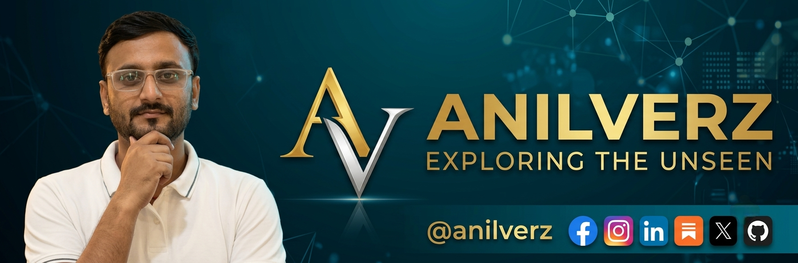

<!-- Image 1. Banner (UNCHANGED) -->

 
 

<!-- Real-time Terminal Typing Animation (Full Width - No Cutoff) -->

 

<!-- 3D Metallic Quick-Access Gateway Plates (Blue, Pink & Gray Theme) -->

  
  
  
  

<!-- 3D Fluid Blue, Pink & Gray Gradient Wave -->

<!-- ================= BLUE, PINK & GRAY GRADIENT ABOUT SECTIONS ================= -->

<table width="100%">
  <tr>
    <td width="100%" valign="top">
      
        
      <h4>🌌 Exploring the Unseen. Questioning What Everyone Accepts.</h4>
      
The world is full of questions we rarely ask, assumptions we rarely challenge, and architectures we have yet to architect.

      
<b>BINAYAKVERZ</b> is an independent research platform and intellectual publication dedicated to exploring advanced software systems, artificial intelligence, and the structural ideas that shape our digital and physical realities.

      
From full-stack software development and artificial intelligence to computer science, system architecture, and philosophy, this is a space for rigorous analytical inquiry.

      
<i>We don’t just write code. We architect solutions, question assumptions, and investigate what lies beyond algorithms.</i>

       
      
    </td>
  </tr>
</table>

 

<table width="100%">
  <tr>
    <td width="100%" valign="top">
      
        
      
<b>Binayak Bhal Chandra</b> is a Professional Software Full Stack Developer and Independent Researcher at <b>binayakverz</b>, specializing in scalable software architectures, artificial intelligence, computer science, and deep technical inquiries.

      
He is also the Founder and CEO of <b>Binayak Bhaiya – Education and Research Center</b>, an educational initiative established in 2013 in Dharhara, Munger, Bihar, India.

      
His technical and analytical approach is guided by three core principles:

      

        
        
        
      

      
The objective is not just to build applications, but to investigate core engineering principles, push the limits of software systems, and foster independent scientific thought.

       
      
    </td>
  </tr>
</table>

 

<!-- ================= RESEARCH & DEVELOPMENT DOMAINS ================= -->

  

 

<!-- Row 1: Full Stack Engineering + AI & Machine Learning -->
<table width="100%">
  <tr>
    <td width="50%" valign="top">
      
      <h4>💻 Full Stack Software Development</h4>
      
Building robust, scalable, and high-performance applications from front-end interfaces to back-end infrastructure, databases, and microservices architecture with clean code and optimal performance.

    </td>
    <td width="50%" valign="top">
      
      <h4>🤖 Artificial Intelligence & Systems</h4>
      
Exploring machine learning models, intelligent agent frameworks, algorithmic efficiency, and the intersection of software engineering with advanced computational intelligence.

    </td>
  </tr>
  <tr>
    <td width="50%" valign="bottom">
      
    </td>
    <td width="50%" valign="bottom">
      
    </td>
  </tr>
</table>

 

<!-- Row 2: Computer Science Theory + Society & Education -->
<table width="100%">
  <tr>
    <td width="50%" valign="top">
      
      <h4>⚙️ Computer Science & Independent Research</h4>
      
Conducting independent research at binayakverz into data structures, network protocols, computational paradigms, and system optimizations that define modern software engineering.

    </td>
    <td width="50%" valign="top">
      
      <h4>📚 Education, Society & Pedagogy</h4>
      
Examining educational methodologies, tech skill development, the future of learning, and empowering young minds through structured technical education and mentorship.

    </td>
  </tr>
  <tr>
    <td width="50%" valign="bottom">
      
    </td>
    <td width="50%" valign="bottom">
      
    </td>
  </tr>
</table>

 

<!-- ================= PODCAST & BOOK ================= -->
<table width="100%">
  <tr>
    <td width="50%" align="center" valign="top">
      
      <h4>🎙️ Beyond Algorithms — Truth Beyond Trends</h4>
      
The flagship podcast within the BINAYAKVERZ research ecosystem. Exploring software engineering, artificial intelligence, system design, and deep technical philosophies beyond mainstream hype.

      
<b>BINAYAKVERZ is the exploration. Beyond Algorithms is the conversation.</b>

       
      
        
    </td>
    <td width="50%" align="center" valign="top">
      
      <h4>📖 Jaguar Vision — Exploring the Mind of AI</h4>
      
A research-driven book project investigating artificial intelligence beyond computational mechanics, looking into synthetic cognition, system architectures, and future software horizons.

      
<b>Distinguishing established technical findings from speculation.</b>

       
      
        
    </td>
  </tr>
  <tr>
    <td width="50%" valign="bottom">
      
    </td>
    <td width="50%" valign="bottom">
      
    </td>
  </tr>
</table>

---

### 🔬 Research & Academic Profiles
Explore Binayak Bhal Chandra’s academic identity, technical research, and scholarly contributions through the following profiles:

| Profile / Registry | Direct Access Link | Node ID |
| :--- | :--- | :--- |
| 🪪 **ORCID** | [https://orcid.org/0009-0005-7901-0926](https://orcid.org/0009-0005-7901-0926) | `0009-0005-7901-0926` |
| 🌐 **Web of Science** | [ResearcherID Profile](https://www.webofscience.com/wos/author/record/RFB-8357-2026) | `RFB-8357-2026` |
| 🎓 **Google Scholar** | [Scholarly Citations](https://scholar.google.com/citations?user=NkFPkh4AAAAJ&hl=en) | `NkFPkh4AAAAJ` |
| 📑 **Zenodo** | [Research & Preprints](https://zenodo.org/records/23103701) | `Record: 23103701` |

---

<!-- ================= TELEMETRY ================= -->

  
    
  

---

<!-- ================= 3D SINGLE-LINE RESPONSIVE SOCIAL DOCK ================= -->

<h3>⚡ Connect With BINAYAKVERZ</h3>

Follow for full-stack architecture insights, research articles, and official updates across platforms (User ID: <b>@anilverz</b>)

  
  
  
  
  
  
  
  

<!-- 3D Sci-Fi Terminal Footer (Blue, Pink & Gray Wave Animation) -->

